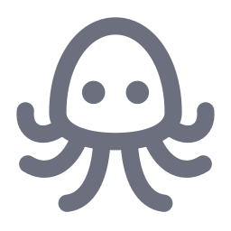

<p align="center"></p>

# Tako

Tako puts coding agents in an IntelliJ tool window. It starts the agent CLI you already have installed and shows the conversation as a chat, with tool calls as cards and file edits in the IDE's diff viewer.

It works with:

- Claude Code (`claude`)
- Codex (`codex app-server`)
- Any agent that speaks the [Agent Client Protocol](https://agentclientprotocol.com), such as Gemini CLI (`gemini --acp`) or OpenCode (`opencode acp`)

## Features

- Answers stream in as the agent writes them
- Before an edit, the permission prompt can open the change in the IDE diff viewer
- After each turn you get a diff of every file the agent touched
- Comment on lines in those diffs, or in any file, and send the comments to the agent together
- Rewind a thread to before one of your prompts and edit it, with or without putting the files back (Claude Code and Codex)
- The diff button in the thread header opens the thread folder's uncommitted changes, its branch against the default branch, or one of its commits in the diff viewer
- The git button commits, pushes and opens a GitHub pull request or GitLab merge request. The thread's agent writes the commit message and description
- Watch a thread's pull request, and the agent wakes up when checks fail or pass, a review comes in, the branch gets conflicts, or it is merged
- In a wide tool window, a work pane beside the conversation lists the thread's changed files, its plan or task list, and its subagents and background tasks
- Implement a plan the agent proposes in a new thread or git worktree, or save it as Markdown
- Agents can start, follow and steer other threads through tools Tako gives them. `/orchestrate <task>` has the agent split a task across threads with the agents and models that suit each part
- Threads are grouped by project. Archive them, or resume a session you started in the agent's CLI
- Pin, rename, snooze or mark threads unread from their menu. A thread whose agent finished or asked something while you looked elsewhere gets a dot until you open it. Optionally archive threads automatically once their pull request is merged or after some days without activity (Settings > Tools > Tako)
- Each thread has its own model, mode and effort
- Switch a thread to another agent between turns. The new agent starts a fresh session and its first prompt carries the conversation so far, cut to about 16k tokens
- Type `@` to mention a file or another thread, paste images, or send the editor, terminal or console selection. Tako attaches large pastes as a text file
- Up and Down in an empty composer recall sent prompts. `Ctrl+S` stashes the draft and brings it back later
- Prompts sent while the agent works queue up. Edit, reorder or remove them, send one now, or steer the running turn with it (Claude Code, Codex)
- Type `/` for the agent's commands and Tako's own, marked Tako: `/model`, `/effort`, `/mode`, `/new`, `/fork`, `/archive`, `/title`, `/restart` and more. `//model` sends `/model` to the agent instead
- Ask a side question with `/side` or `/btw` while the thread works, then bring the answer back into its composer
- Fix Problems sends a file's inspection results to the agent
- For Claude Code, a context meter and a usage view with cost and tokens per session
- When Claude Code or Codex stops on a usage limit, the thread says when the limit resets and can send a continue prompt then
- A status bar widget counts threads that are working or waiting for you
- Optional parallel runs: one prompt goes to several agents or models at once, each in its own git worktree. Compare what each changed, cost and took, then apply the best one

## Requirements

- An IntelliJ-based IDE, 2026.2 or newer
- At least one agent CLI, either on your `PATH` or with its path set in the settings
- For pull requests: the [GitHub CLI](https://cli.github.com) (`gh`) or, for GitLab, [`glab`](https://gitlab.com/gitlab-org/cli), logged in

## Installation

In the IDE, open Settings > Plugins > Marketplace, search for Tako and install it. To try the latest changes, install a [nightly build](#nightly-builds) instead.

## Usage

Open the Tako tool window on the right, click New Tako Chat, pick an agent and type.

In the editor or project view, right-click and choose Tako > Add to Tako (`Ctrl+Alt+Shift+K`) to attach the selection or file. Fix Problems with Tako is in the same menu.

To comment on the agent's changes, select lines in a diff Tako opened, right-click and choose Comment for Tako. Type the comment and press Enter. It lands in the composer of the thread that made the change, with the file, the lines and the code, so you can collect several and send them in one prompt. Sending only comments asks the agent to address them. Declining a proposed edit sends the comments made in its diff as the reason, if the agent reads one. In a file's editor the same command is under Tako, and the comment goes to the current thread.

Settings are under Settings > Tools > Tako. The top page sets the agent for new threads. Each agent has its own page below it for the executable and the default model, mode and effort. ACP agents go in a table, one name and command line per row.

### Queued prompts and steering

A prompt sent while the agent works waits under the conversation until the turn ends. Each queued prompt has Send now, which stops the turn and sends it next, Steer, which hands it to the running turn without stopping it, Edit, which moves it back into the composer, Move up and Remove. Ctrl+Enter steers instead of queuing, and Settings > Tools > Tako swaps the two. Agents that can't take a prompt mid-turn, such as ACP agents, always queue.

Stopping the agent, a failed turn or the agent's process ending holds the queue: nothing more is sent until you send a prompt or press Send on one. Prompts still queued when the thread is archived or closed, or the IDE exits, go to the prompt stash.

### Rewind

Hover over a prompt you sent and click the rewind button. Rewind conversation makes the agent forget that prompt and everything after it, and puts the prompt back into the box to edit. Rewind conversation and files also puts the files in the thread's folder back to how they were when the prompt was sent, your own changes since then included.

For the files, Tako snapshots the thread's folder in git each time you send a prompt while the agent is idle. The snapshots are commits under `refs/tako/checkpoints/<thread>`, outside your branches and index, and are deleted when the thread is closed. Ignored files are not part of them. Before it restores files, Tako keeps the state it replaces under `refs/tako/backup/<thread>`. Without a git repository only the conversation can be rewound.

Claude Code continues in a copy of its session. The old session stays in the session history. Codex reverts the thread in place, which needs a Codex version with `thread/revert`. ACP agents can't rewind.

### Usage limits

When Claude Code or Codex stops because a subscription or rate limit ran out, a banner above the composer names the limit and when it resets. Resume at reset sends "Continue where you left off." a minute after the reset. Edit prompt changes that text, and Cancel resume or the X drops it. Snooze until reset hides the thread until then. Sending a message yourself, archiving or closing the thread drops it too. A command that only shows something, such as `/usage` or `/status`, keeps it. The schedule survives an IDE restart and goes out once the Tako tool window is open again, up to a day late. When several threads wait for the same agent, they resume 30 seconds apart. Agents that report no reset time, and ACP agents, get no schedule.

### Side chats

A side chat answers a question about a thread without adding to it. Type `/side` or `/btw` and your question, or click the side chats button in the header. The side chat opens beside the thread, or over it when the tool window is narrow, and the thread keeps working.

With Claude Code the side chat continues a copy of the thread's session up to its last finished turn. Codex and ACP agents start a new session, with the thread's prompts and answers attached as a Main thread chip.

Each answer in a side chat has a Bring back button, which quotes the answer in the thread's composer. Side chats show only in their thread's pane, not in the thread list. Archiving a thread stops its side chats, and closing it closes them.

### Pull requests

The git button in the thread header offers Commit, Commit and Push, Push, and Create Pull Request, or Merge Request on GitLab, also self-hosted. Tako asks the thread's agent for the commit message and the pull request's title and description, and shows them for editing before it runs anything. Pull requests use `gh` or `glab` and need a branch other than the default one.

The watch button in the header watches the branch's open pull request. Tako checks it every 2 minutes and wakes the agent when checks fail or pass, someone reviews or comments, the branch gets merge conflicts, or the pull request is merged or closed. Agents can start and stop a watch themselves.

### Threads that start threads

Tako gives every agent tools to list the agents you set up, start threads, read and message other threads, wait for them and stop them. Threads an agent starts are nested under it in the sidebar, and can run in their own git worktree.

`/orchestrate <task>` makes the thread's agent the orchestrator for one task. It plans the task, does the small parts itself, hands the rest to new threads, then checks their results. To steer its choice of agent, model and effort, describe what suits which work in the Delegation field under Settings > Tools > Tako, e.g. "sonnet: mechanical edits. codex: hard debugging."

### Parallel runs

Turn on Parallel runs under Settings > Tools > Tako. A new thread's composer then has a runs picker. Choose how many runs to start, and optionally a different agent and model for each. Sending creates one git worktree per run from the last commit, in a `<repo>-tako` folder beside the repository, and one thread per run, grouped in the sidebar. Uncommitted changes are not copied into the worktrees. Each worktree is a fresh checkout without dependencies or build output; a `.worktreesetup` file sets them up, see below.

Local config can come along: list gitignored files like `.env` or `.mcp.json` in a `.worktreeinclude` file in the repository root, in `.gitignore` syntax, as for Claude Code. Tako copies them into every worktree it creates, for parallel runs and for threads an agent starts in a new worktree. Tracked files and files the worktree already has are left alone. Folders git ignores as a whole, like `build`, are only searched when a pattern names them or a path in them.

To install dependencies or build in each new worktree, put shell commands in a `.worktreesetup` file in the repository root, one per line, e.g. `npm ci`. Lines starting with `#` are comments. Tako runs them in order in the worktree's top folder before it starts the agent, with `cmd.exe` on Windows and `/bin/sh` elsewhere, and shows their progress and output above the composer. Each line runs in its own shell, so `cd` does not carry over. `TAKO_WORKTREE` and `TAKO_REPOSITORY` hold the paths of the worktree and of the main checkout. The worktree's own copy of the file is used if it has one, else the main checkout's, so the file can be committed or gitignored. When a command fails, or the setup takes more than 20 minutes, the prompt waits: Retry runs the file again, Start without setup sends the prompt anyway. Stop cancels the setup. Tako only runs the file in trusted projects. Keep what the commands create gitignored, or it counts as the run's changes.

The group's compare button lists each run's changed files, lines, cost, tokens and time. Diff opens a run's changes in the IDE diff viewer. Apply puts a run's changes into your checkout as uncommitted changes, then removes all the bench's worktrees, branches and threads. Discard removes them without applying anything.

### Signing in

Codex and ACP agents use their own CLI login. Run `codex login`, for example.

Claude Code is different. Tako passes it an Anthropic API key, which it keeps in the IDE password safe. [Anthropic doesn't allow](https://code.claude.com/docs/en/agent-sdk/overview#get-started) third-party tools to offer a claude.ai subscription login without its approval. There is a Claude CLI login option, but you use it at your own risk.

## Building

Gradle needs JDK 17 or newer to start. It downloads JDK 25 for the build on its own.

```sh
./gradlew buildPlugin   # plugin zip in build/distributions
./gradlew runIde        # sandbox IDE with the plugin
./gradlew check         # tests, Checkstyle, formatting
./gradlew verifyPlugin  # JetBrains Plugin Verifier
./gradlew spotlessApply # format Java and Kotlin
```

The build downloads the IntelliJ IDEA version in `gradle.properties` (`platformVersion`). To build against an IDE you already have, set `tako.platformLocalPath` in `~/.gradle/gradle.properties` to its folder.

### Nightly builds

Every push to `master` builds the plugin and replaces the [nightly pre-release](https://github.com/firebiteio/tako/releases/tag/nightly) with the new zip. Install it with Settings > Plugins > Install Plugin from Disk. Nightly builds are not signed.

### Releasing

Push a tag like `v0.2.0`. The release workflow builds that version, runs the checks, signs the plugin, publishes it to the JetBrains Marketplace and creates a GitHub release with the signed zip. It needs these repository secrets:

- `PUBLISH_TOKEN`, a JetBrains Marketplace token
- `CERTIFICATE_CHAIN`, `PRIVATE_KEY` and `PRIVATE_KEY_PASSWORD` for [plugin signing](https://plugins.jetbrains.com/docs/intellij/plugin-signing.html)

Publishing can only update a plugin that already exists on the Marketplace, so upload the first version by hand.

## License

Copyright 2026 The Tako Authors. Licensed under the [Apache License 2.0](LICENSE).
